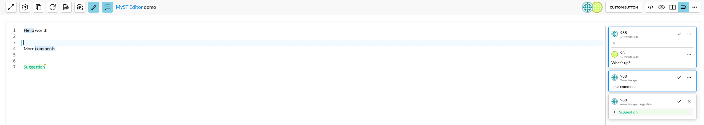
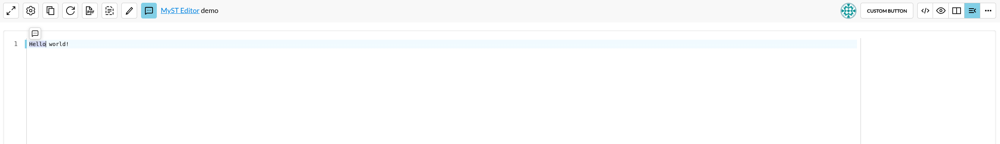
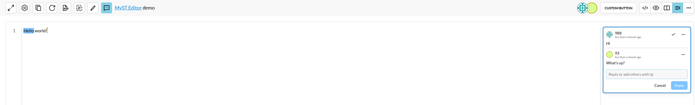
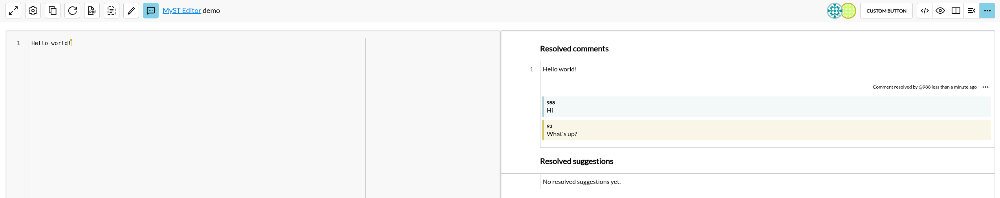
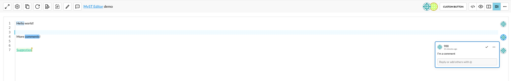

# Comments

To leave feedback for other users collaborating on a document without changing the document text itself, you can leave comments.
:::{figure-md} comment-show


Comments have a blue color and border.
:::
## Adding a Comment

:::{figure-md} comment-add


Add comment
:::

To add a comment, select the text you want to comment on. This should make the comment icon appear.
Click on the icon to create a comment.

```{tip}
You can use multiple selection with CTRL to select multiple texts that are apart.
```


## Collaborating on a Comment

:::{figure-md} multiple-authors


Discussion on a comment
:::

Each comment can have it's own discussion. You can do this by clicking on the comment and filling the input field.

## Editing and deleting comments
After clicking the 3 dots next to an author of the comment u can either edit the comment or delete it.
Edits are prohibited only to author of the comment.

```{warning}
Deleting the top comment will also delete the disscussion.
```

```{tip}
If you deleted the comment by accident u can undo your changes by clicking `CTRL + Z`
```

## Resolving Comments
To resolve a comment, click the resolve comment button in the comment card.
This will move it to the `Resolved Comments` view in the [topbar](topbar.md) where it will be accessible.
Click the `Resolved Comments` button to see it.
Such comments are annotated with the following information:

- Comment author
- User who resolved the comment
- Comment resolution time
- Origin text line
- Disscussion

You can access more options by hovering over the `...` button in the top right of a comment.

:::{figure-md} comment-resolved


Resolved comment
:::

### Restoring Comments

After a comment is resolved, it will keep track of the line it was attached to.
<!-- Should the text in the line or its line number change, it will be reflected in this view. -->
You can bring back a comment to the editor by clicking the restore button in the `...` menu.


### Collapsed comments
Comment and suggestion cards start expanded when the editor is at least 800 px wide and collapsed when it is narrower. Crossing that width resets the cards to the corresponding state. You can also expand or collapse them using the `Toggle full comments and suggestions` button in the [topbar](topbar.md).
:::{figure-md} collapsed-comments


Collapsed comments
:::
