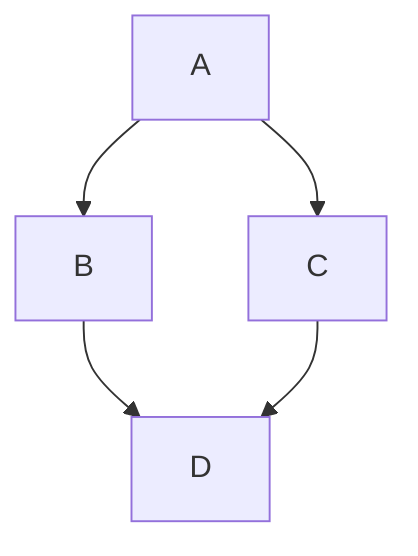
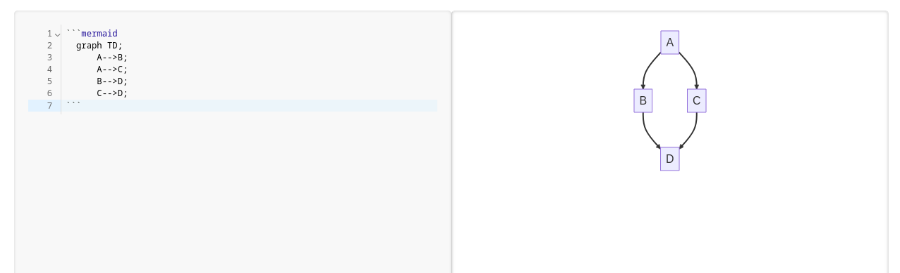

# Mermaid Diagrams

MyST allows users to include Mermaid diagrams in their documents. The editor renders them with [Pele](https://pele.run/).
For an explanation on how to create diagrams, refer to the `Diagram Syntax` section of the [Mermaid Documentation](https://mermaid.js.org/intro/).
Here is an example graph in MyST:

````md

````

:::{figure-md} mermaid-graph


Mermaid Graph
:::
