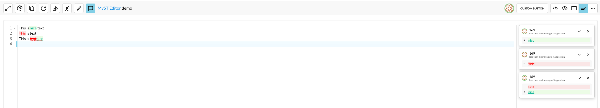

# Suggestions

:::{figure-md} suggest-change


Suggestion example
:::

You can make use of the `Toggle suggest mode` to add suggestions in a document.
You can accept or reject suggestions using the buttons visible in a suggestion card beside the editor. After clicking the suggestion card it allows you to comment on the suggestion.

```{tip}
You can make replace suggestion by selecting text you want to replace and start typing your suggested changes.
```

## Resolved suggestions 

To see Resolved suggestions and it's comments open the resolved panel hidden in the [topbar](topbar.md).

## Suggestion undo/redo

Suggestions you made are remembered so you can use `CTRL + Z` to undo your suggestion or `CTRL + Y` if u want to reapply your suggestion after deletion.
